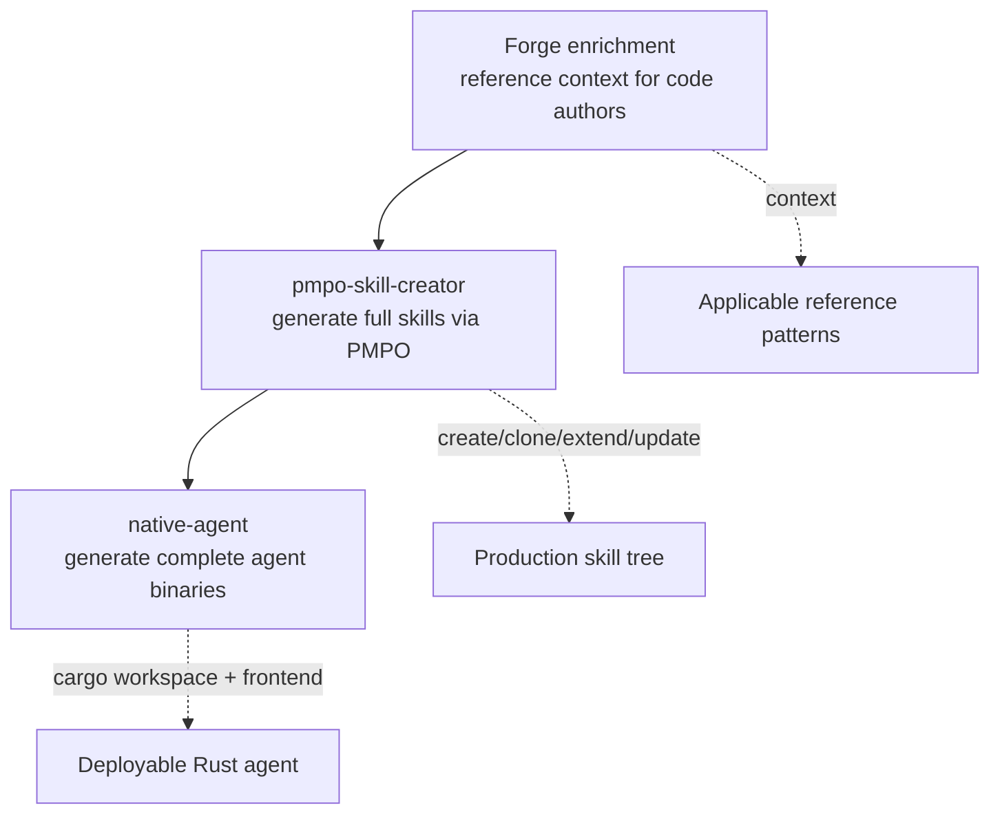

# 14 · The Rust Toolchain & Dynamic Generation

Every binary in this system is Rust. That is not an aesthetic choice — it is a structural one, and it is what makes the most distinctive capability of the pack possible: the system can generate new skills, new CLIs, new MCP servers, and complete agents *on demand*, compile them, and install them. This page covers why Rust, how the binaries are built, and how the dynamic-generation machinery works.

## Why Rust

The tools in this pack run as persistent background services that loops depend on every turn — the knowledge base, the memory graph, the enrichment engine, the model gateway. For that role, three Rust properties are load-bearing.

**Predictable tail latency.** A loop turn that stalls because a service hit a garbage-collection pause is a loop turn that wastes tokens and erodes trust. The `performance` and `rust-perf-primitives` patterns in this pack — jemalloc, `#[cold]` error paths, `MaybeUninit`, `parking_lot` over `std::sync` — exist specifically to keep p99 latency flat under production load.

**A single binary with no runtime.** Each tool ships as one statically-useful binary copied to `~/.local/bin/`. There is no interpreter to provision, no virtual environment to activate, no dependency tree to resolve at runtime. That is what lets `install-binaries.sh` set up the whole toolchain on a fresh machine in one pass.

**Compile-time guarantees at the FFI and WASM boundaries.** The pack crosses language boundaries constantly — Rust↔Python via PyO3, Rust↔Dart via flutter_rust_bridge, Rust→WASM via the LibreFang ABI. Rust's ownership model is what makes those boundaries safe to generate automatically rather than hand-audit every time.

## Installing the toolchain

The Rust toolchain itself is the one prerequisite the pack cannot install silently, because it is the thing that builds everything else.

```bash
# Install rustup + the stable toolchain
curl --proto '=https' --tlsv1.2 -sSf https://sh.rustup.rs | sh

# Add the WASM target used by librefang-wasm-skill and the native-agent WASM build
rustup target add wasm32-unknown-unknown

# Confirm
rustup show
cargo --version
```

Go and Node are detected and, where possible, installed by the prerequisite script; the Go toolchain backs the `go/go-base-patterns` skill and the Flint Go SDK, and Node backs the React/TypeScript/HTMX skills and the JS-based installers. The full prerequisite and install flow is on the [Installation](19-installation.md) page. The single command that builds and installs the selected source-owned binaries is:

```bash
bash scripts/install-binaries.sh --dry-run   # print every build and copy; change nothing
bash scripts/install-binaries.sh
# builds and installs to ~/.local/bin/, skipping any whose source is absent:
#   prometheus-exec, prometheus, forge, pk, pk-cherry, prometheus-learning-worker,
#   learner-model, surface-bridge, liter-llm, openai-proxy, surreal-memory-server
#   (plus surreal-memory-mlx-executor on Apple Silicon), sycophancy-correction, template-forge, template-forge-mcp, cowork, co, dsg,
#   prometheus-research

# or, the higher-level path that also checks prerequisites:
bash scripts/check-prerequisites.sh --install --build-tools
# doctor is a separate read-only diagnostic path
```

### Machines that keep build output outside the repository

Cargo writes release binaries to `<workspace>/target/release` unless the machine redirects its target directory. If yours does, state the location in the environment, using the variable cargo itself reads:

```bash
# in ~/.bash_profile (or the profile of whichever shell you use)
export CARGO_TARGET_DIR="/path/to/your/cargo-target"
```

One variable then drives everything: cargo builds into that directory, `scripts/install-binaries.sh` and `scripts/install-skills-flat.sh` install from it (they ask cargo, which reports it), and `prometheus doctor`, `prometheus setup` and `prometheus memory` read it directly.

The `prometheus` CLI does not read cargo config files. A target directory set only as `build.target-dir` in a `.cargo/config.toml` is honored by the shell installers but is invisible to the CLI, which then looks in `<workspace>/target/release` and reports a missing or stale binary. Export the same path as `CARGO_TARGET_DIR` on such a machine.

A shell profile is read only by shells started from it. A launchd or systemd service, or an app not launched from your shell, does not inherit the variable.

**When to set it.** Set `CARGO_TARGET_DIR` only if build output already lives outside the repository on this machine, for example on a larger or faster disk. A machine using cargo's default needs nothing. Setting it makes every workspace build into one directory, so the one-build-at-a-time rule matters more: two builds writing there at once corrupt each other's output.

**Check that it took effect.** Preview the installer, then compare hashes from the repository root:

```bash
bash scripts/install-binaries.sh --dry-run   # each "would install" line names the source it will read
prometheus doctor --json --check binaries.manifest
```

In the doctor details, `source sha256` should equal `shasum -a 256` of the file you just built. `source sha256 not-built`, or a source hash that never changes after a rebuild, means the CLI is looking in the wrong directory. Do not expect `source` and `installed` to be equal on macOS: the installers re-sign each binary after copying it, which rewrites the file. [Doctors and Mac certification](/docs/operations/doctors-and-mac-certification#managed-binary-check) explains the check.

### Reproducible builds and the `prometheus-exec` pin

`prometheus-exec` is the one binary whose exact bytes are certified. Build it only through `scripts/build-prometheus-exec.sh`, which removes the checkout path, out-of-workspace dependency paths and the toolchain's `rust-src` location from the binary, and always copies its output to `crates/prometheus-exec/target/release/`. Its installer then requires the hash pinned for this machine's Rust host target in `config/prometheus-exec-binary.json`.

```bash
bash scripts/build-prometheus-exec.sh --print-hash   # the hash this machine produces
bash scripts/install-prometheus-exec.sh --dry-run    # the hash and target the installer requires
```

The two values should be equal. If they differ and nothing under `crates/prometheus-exec`, `substrate/exec-*`, `wit/` or the pinned toolchain changed, the build is not reproducible on that machine; do not paper over it by updating the pin. [The certified build hash](/docs/execution/installation-doctor-and-recovery#the-certified-build-hash) covers when and how to recertify.

## Dynamic generation — three layers

The pack generates new capability at three levels, each building on the one below.



### Layer 1 — Forge enrichment

Forge reads an OpenSpec task and renders applicable reference patterns into an agent context document. The shipped CLI supports `init`, `enrich`, `reflect`, `drift`, `validate`, `status`, `mcp`, `skill`, `constitution` and `package-librefang`. It has no template-management subcommand; the old meta-template files do not establish an executable CLI.

```bash
forge init
forge enrich openspec/changes/example/tasks.md
forge validate src/main.rs --language rust
```

These commands need an actual project/task and installed binary. Enrichment supplies the task description/identity/path, acceptance criteria, constitution summary and bounded Karpathy focus; arbitrary template variables are not supplied. See [Forge and template runtimes](14a-forge-rs.md) for source limitations.

### Layer 2 — pmpo-skill-creator

The middle layer generates *complete skills* through the PMPO loop, in four modes — create, clone, extend, update — producing a full tree (`SKILL.md`, prompts, agents, references, schemas, scripts, sub-skills, `hooks/hooks.json`, `.claude-plugin/plugin.json`) that passes strict validation. Its human-gated `--update` mode is what turns observed learning into an actual skill change, and it is covered in detail on the [Process & Orchestration Skills](09-process-skills.md) page. The important property: a generated skill is held to the same `npm run validate:strict` bar as a hand-written one.

### Layer 3 — native-agent

The top layer generates a complete, deployable agent — a six-crate Cargo workspace (seven with its optional WASM adapter), a React 19 frontend, three interop protocols, and a management CLI — validated with `cargo check` and `npm install` before it is handed back. The full treatment is on [The Native Agent Generator](12-native-agent-generator.md) page. The WASM build target compiles the generated skill against the LibreFang Guest ABI for `wasm32-unknown-unknown`, which is the same target you added with `rustup target add` above.

## Generating native skills, CLIs, and MCP servers

Three Rust skills exist specifically so that the things the pack generates are themselves well-formed:

- **mcp-server** encodes the canonical Axum MCP server (JSON-RPC 2.0 over `POST /mcp`, SSE at `GET /events`, stdio transport). Every MCP server the pack generates follows this pattern.
- **workspace-structure** encodes the multi-crate layout (`*-core`/`*-store`/`*-librarian`/`*-mcp`/`*-cli`) that every generated tool workspace uses.
- **librefang-wasm-skill** encodes the WASM-ABI skill shape for sandboxed, capability-checked execution.

The result is a closed loop at the toolchain level: the pack uses Rust skills to generate Rust tools that the loops depend on, audits them with `prometheus-rust-auditor`, and — when a generated skill proves useful — promotes it through the human-gated update flow. The `start-business-build` pipeline chains the whole sequence: ideation-mindmap → iterative-evolver → skill/agent generation → validation. That is dynamic creation of agents, skills, and native tools, end to end.

## Generation ends before evidence-producing execution

The installed toolchain creates and validates programs. It does not make every generated program a Prometheus Exec operation.

- Generated Python, Node, or Bash can enter Tier P when the job is bounded and needs isolation, replay, artifacts, or a signed receipt.
- Generated Rust can enter Tier W only after it is compiled as a component implementing `prometheus:component@0.1.0` and its exact bytes are authorized.
- Generated native CLIs and services are built, installed, and operated normally; Tier P does not launch arbitrary native binaries.
- Generated native agents own long-lived model, protocol, UI, and lifecycle responsibilities. They may delegate a bounded sub-job through an explicit Exec adapter.

This separation keeps authoring flexible and makes execution authority reviewable. See [Generate programs, then choose how they run](/docs/execution/generating-programs).

## Quality enforcement on generated Rust

Generated Rust does not get a pass on quality. `prometheus-rust-auditor` runs the same staged pipeline — Clippy enforcement, formatting, dependency policy, workspace inventory, partition-based architectural invariants, and CI generation — against generated code as against hand-written code. The architectural invariants (`actor_no_shared_mutable_state`, `wasm_unsafe_confined`, `async_cancellation_safe`) are exactly the properties that are easy to violate when generating concurrent Rust automatically, which is why they are checked rather than assumed.

---

*Previous: [← 13 · Tools Reference](13-tools-reference.md) · Next: [15 · Hooks & Lifecycle →](15-hooks-and-lifecycle.md)*
