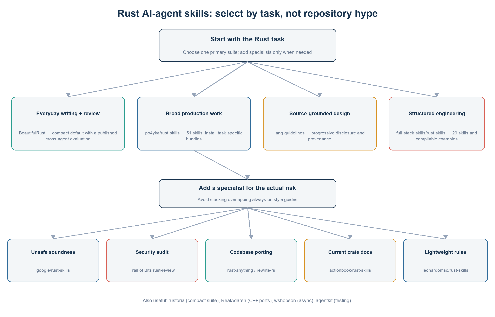
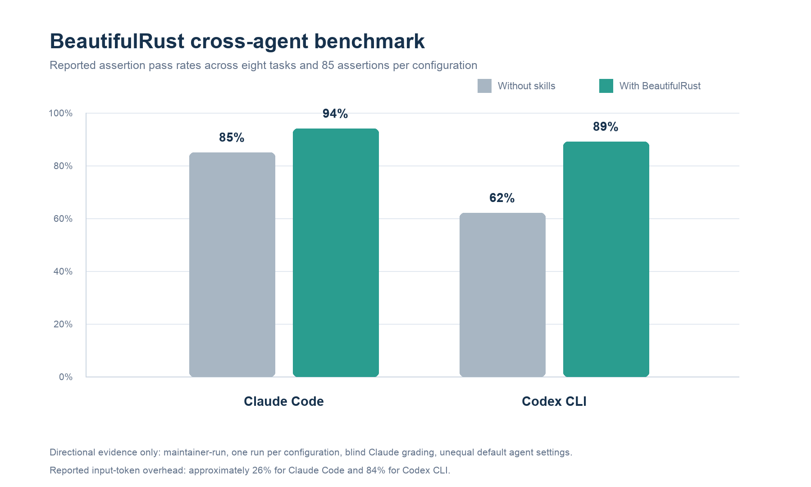

# The Best AI-Agent Skills for Rust Development

**Research date:** 24 November 2026
**Scope:** Reusable `SKILL.md` packages, agent plugins, instruction libraries, and tightly integrated agent workflows for writing, reviewing, testing, securing, and migrating Rust code.

This survey compares third-party Rust skills as of the research date. For the skills shipped with this pack and guidance on choosing one for a task, see the [Prometheus Rust workspace routing guide](../../../skills/rust/prometheus-rust-workspace/references/skill-routing.md).

## Executive Summary

There is no sensible single winner for every Rust task. The strongest default for most users is **[BeautifulRust](https://github.com/morganlinton/BeautifulRust)** because it combines three focused skills—writing, review, and porting—with tested Clippy configuration, compile-checked examples, broad installation options, and a published cross-agent evaluation. For teams that need deeper production coverage, **[po4yka/rust-skills](https://github.com/po4yka/rust-skills)** is the most impressive comprehensive catalog inspected: its 51 skills address unsafe code, atomics, FFI, mobile and desktop integration, embedded, WASM, networking, debugging, supply-chain security, sanitizers, and verification. For an always-on design guide with strong provenance and disciplined progressive disclosure, **[youssef-tharwat/lang-guidelines](https://github.com/youssef-tharwat/lang-guidelines)** is the best source-grounded alternative. These three packages solve different problems and should not all be installed as overlapping global style authorities. [BeautifulRust](https://github.com/morganlinton/BeautifulRust), [po4yka/rust-skills](https://github.com/po4yka/rust-skills), [lang-guidelines](https://github.com/youssef-tharwat/lang-guidelines)

Specialist choices are clearer. **[google/rust-skills](https://github.com/google/rust-skills)** is the strongest focused resource for rigorous unsafe-Rust soundness review; **[Trail of Bits’ rust-review](https://github.com/trailofbits/skills/tree/main/plugins/rust-review)** is the most comprehensive security-audit workflow; **[erkamyaman/rust-anything](https://github.com/erkamyaman/rust-anything)** is the best tool-backed migration system because it records and replays behavior rather than merely instructing an agent to translate code; and **[rewrite-rs/skills](https://github.com/rewrite-rs/skills)** is the best instruction-only porting collection. **[full-stack-skills/rust-skills](https://github.com/full-stack-skills/rust-skills)**, **[leonardomso/rust-skills](https://github.com/leonardomso/rust-skills)**, **[rustoria](https://github.com/uswuth/rustoria)**, and **[actionbook/rust-skills](https://github.com/actionbook/rust-skills)** fill important niches in structured engineering, lightweight rules, compact library coverage, and current crate documentation respectively. The table below is therefore a task-oriented shortlist, not a popularity ranking. Readers with mixed needs should use the later operating model to combine one general suite with narrowly invoked specialists, rather than interpreting every listed repository as a simultaneous installation recommendation.

| Need | Best selection | Why it earned the position |
|---|---|---|
| Best default for everyday Rust | **BeautifulRust** | Three coherent workflows, tested lints, compiled examples, published evaluation, MIT license |
| Best comprehensive production suite | **po4yka/rust-skills** | 51 deep skills, strong verification culture, exceptional unsafe/FFI/platform coverage |
| Best source-grounded design rules | **lang-guidelines** | 92-rule card, six-pattern index, gated cards, source provenance, repeated A/B evaluation |
| Best structured general engineering suite | **full-stack-skills/rust-skills** | 29 skills spanning language, Cargo, API design, testing, web, data, and operations |
| Best lightweight rule library | **leonardomso/rust-skills** | 265 rules in 26 categories with a low-cost index and compile-checked examples |
| Best compact native-and-library suite | **rustoria** | 14 skills, deep references, compile-tested examples, security and unsafe coverage |
| Best unsafe-code review | **google/rust-skills** | Proof-obligation methodology grounded in Rust semantics and real audit findings |
| Best security-audit workflow | **Trail of Bits rust-review** | Capability-gated clusters, empirical bug research, worker/reviewer orchestration, SARIF |
| Best tool-backed migration | **rust-anything** | Behavioral recording, differential replay, fuzzing, benchmarking, gates, and rollback |
| Best instruction-only migration suite | **rewrite-rs/skills** | Shared parity spine plus dedicated C, C++, Go, Java, Python, and TypeScript skills |
| Best dynamic crate-documentation workflow | **actionbook/rust-skills** | Generates current crate skills and adds routing, navigation, and analysis utilities |
| Best focused C++ porting guide | **RealAdarsh/cpp-to-rust-skill** | Detailed C++-specific redesign, FFI, concurrency, build, and parity references |
| Best small async or testing additions | **wshobson/agents; agentkit** | Focused Tokio patterns and practical Rust testing-tool guidance |

## 1. Research Scope and Evaluation Method

The research treated “skill” as a reusable capability consumed by an AI coding agent, not as a Rust tutorial, a crate, or an AI agent merely implemented in Rust. Included artifacts use the open Agent Skills format, expose closely related `AGENTS.md` or plugin workflows, or combine a skill with tools that the agent invokes. The open specification recommends progressive disclosure: metadata is available at startup, the main instructions load on activation, and references or scripts load only when required. This makes routing quality, concise entry files, and well-organized references genuine engineering criteria rather than packaging preferences. Compatibility claims in this report distinguish the portable file format from client-specific features such as subagents, plugin marketplaces, MCP servers, or automatic tool permissions. [Agent Skills specification](https://agentskills.io/specification)

The discovery process used twelve distinct web-search rounds covering general packages, official sources, security, embedded and WASM, backend development, migration, testing, and registries, followed by direct GitHub inspection of leading repositories. Repository structure, actual skill directories, evaluation assets, licenses, latest relevant commits, and stated compatibility were checked. Maintainer-published benchmarks were analyzed but not rerun; compile and validation harnesses were inspected rather than executed locally. GitHub stars are reported only as repository-level adoption snapshots, never as evidence that a skill improves code. Very new packages can outrank older popular ones when their technical content and verification design are stronger, but their limited track record is explicitly retained as a risk.

| Criterion | What received credit | What reduced confidence |
|---|---|---|
| Technical depth | Concrete invariants, failure triage, decision tables, verification limits, useful references | Generic “write idiomatic Rust” prompts or snippet collections |
| Verification | Compilable examples, fixture probes, CI, baseline arms, repeated outcome evals | Unsupported quality claims or only structural/frontmatter checks |
| Agent design | Focused triggers, progressive disclosure, clear ownership, minimal overlap | Monolithic prompts, duplicated rules, unclear routing, always-on bloat |
| Portability | Standard skills plus documented client-specific installation | Untested plugin claims presented as proven compatibility |
| Maintenance | Recent substantive commits, releases, changelogs, current toolchain notes | One-day content drops, stale versions, or repository activity unrelated to the skill |
| Adoption and governance | Traceable authorship, license, provenance, security notes, real usage | Anonymous mirrors, unclear licensing, inflated directory metadata |
| Operational safety | Sandboxing guidance, side-effect warnings, explicit limits of tests and audits | Instructions that run code or bless output without adequate safeguards |

## 2. Best General-Purpose Rust Skill Suites

The six packages in this section can plausibly serve as a primary Rust capability layer, but they embody different trade-offs. BeautifulRust favors a small, coherent workflow; po4yka favors deep specialization; lang-guidelines favors source-traceable design judgment; full-stack-skills favors a complete engineering curriculum; leonardomso favors inexpensive rule lookup; and rustoria favors a compact native-Rust-plus-libraries arrangement. Selecting more than one as an always-on global default would often be counterproductive because their triggers overlap and their style rules can compete. A better pattern is to choose one primary suite, install only the modules needed by the repository, and add specialist security or migration tools for separate tasks.

### 2.1 BeautifulRust — best default for most users

BeautifulRust contains `rust-best-practices`, `rust-review`, and `rust-port`, plus Cargo and Clippy lint configuration. Its guidance synthesizes the Google Rust Style Guide, Rust API Guidelines, Effective Rust, Rust Design Patterns, and Microsoft’s Pragmatic Rust Guidelines, with condensed references bundled for on-demand reading. The writing skill covers ownership, API design, errors, concurrency, unsafe/FFI, dependencies, documentation, testing, and performance; the review skill produces prioritized findings tied to rules and fixes; and the porting skill starts with the original tests and records behavioral differences. Every documented code example is checked on stable Rust, and the lint test crate is designed to prove that each configured lint fires. [BeautifulRust repository](https://github.com/morganlinton/BeautifulRust)

Its strongest differentiator is a published October 2026 cross-agent benchmark covering eight tasks and 85 assertions per configuration. Reported totals improved from 72/85 to 80/85 for Claude Code and from 53/85 to 76/85 for Codex CLI. The maintainer also publishes a regression, token overhead, unequal runtime settings, and the fact that there was only one run per configuration with a Claude model grading blinded outputs. Consequently, the result is meaningful directional evidence, not an independent or statistically strong benchmark. BeautifulRust is also young—created on 23 October 2026, with the inspected latest commit dated 8 November—and its three skills do not attempt the platform depth of po4yka. It remains the best-balanced starting point because scope, usability, and evidence are unusually well aligned. [Benchmark method and caveats](https://github.com/morganlinton/BeautifulRust/blob/main/benchmarks/cross-agent-2026-10/README.md), [latest inspected commit](https://github.com/morganlinton/BeautifulRust/commit/b9718436d77ee7bcf17cdcb6aa27628feb95d97a)

### 2.2 po4yka/rust-skills — best comprehensive production suite

The inspected catalog contains **51 skill directories**, covering compiler errors, borrow and pattern semantics, crate architecture, macros, iterators, variance, callback bounds, type erasure, Cargo workflows, releases, native linking, Serde, security, Android, iOS, cross-compilation, WASM, embedded, testing, Miri and sanitizers, panic safety, porting, review, memory models, async internals, unsafe code, pin projection, `Send`/`Sync`, event loops, performance, hot paths, copy-on-write, debugging, observability, networking, databases, JNI, Swift FFI, PyO3, CXX, and UniFFI. This is not merely broad naming: skills such as `rust-test-tools` distinguish Miri, ASan, TSan, Loom, cargo-fuzz, mutation testing, and differential fuzzing by bug class and explicitly state what a green run cannot prove. The suite’s depth makes it especially suitable for production systems, unsafe boundaries, and cross-platform Rust. [po4yka catalog](https://github.com/po4yka/rust-skills)

The repository also has the most elaborate evaluation design inspected: routing tests, real-client plugin tests, and nine outcome cases with planted defects, reference fixes, offline fixtures, multiple runs, and a cross-agent runner. Its documentation carefully states that routing accuracy does not prove automatic client triggering, nine cases do not represent all 51 skills, and small judge deltas are not necessarily real. The trade-off is operational complexity: installing the whole catalog creates a large routing surface, and many modules are unnecessary for an ordinary web service. Use bundles or select skills individually. The project reached v0.5.0 on 13 November and received a dependency update on 18 November, but had only seven GitHub stars at inspection, illustrating why adoption counts should not dominate the assessment. [Evaluation design](https://github.com/po4yka/rust-skills/blob/main/evals/README.md), [v0.5.0 commit](https://github.com/po4yka/rust-skills/commit/0d0b9462c8f51532253af6e20458d934b24c8bf7)

### 2.3 lang-guidelines — best source-grounded design rules

The Rust component of `lang-guidelines` combines Microsoft’s Pragmatic Rust Guidelines, the Rust API Guidelines, Google’s Rust style guidance, and community design patterns. Its always-loaded entry is a 28 KB card containing 92 rules and a six-pattern index; setup, FFI, and performance cards add 19 rules only when triggered, while complete upstream rules and patterns remain available on demand. Mechanical enforcement is deliberately delegated to `rustc` and Clippy rather than duplicated in prose. The build compiler maps every upstream unit to a rule, pattern, lint, or documented exclusion, while provenance files record origin, date, and hashes. This is an excellent architecture for a team that wants auditable design guidance rather than an opaque prompt. [lang-guidelines architecture](https://github.com/youssef-tharwat/lang-guidelines)

The maintainer has also run repeated A/B evaluations, including three runs per arm and an A/A noise-floor experiment. Recent commit notes are unusually honest: some restructures reduced scores and were not adopted, and a small number of with-skill runs never loaded the skill. This evidence concerns layout and rule effectiveness on the maintainer’s cases, not universal Rust correctness, but it is stronger methodological practice than a single uncontrolled demonstration. The package is not a substitute for dedicated unsafe, security, embedded, or migration workflows, and its mixed upstream licenses require preserving the stated attributions. It is the best choice when the main goal is consistently good design at write time with low unnecessary context loading. [Evaluation notes](https://github.com/youssef-tharwat/lang-guidelines/commit/5f36c8288ff04ba6dbeb4b07d7c32aec45e412db)

### 2.4 full-stack-skills/rust-skills — best structured engineering suite

This package contains **29 skills** arranged around language semantics, standard-library and example-driven patterns, API design, project engineering, specialized domains, operational evidence, and quality gates. It is particularly strong in areas often omitted from style-focused packages: module layout, Cargo configuration, dependency governance, semver checks, documentation, HTTP clients, database verification, observability, performance evidence, and Java-to-Rust migration. Its `rust-api-design` skill implements roughly one hundred API-guideline rules with a compiled golden crate, and the repository provides validation for manifests, frontmatter, links, code fences, Codex metadata, and compilable examples. That breadth makes it a strong candidate for teams that want explicit review and delivery procedures as well as coding rules, rather than relying on a model to infer those procedures from general advice. [full-stack-skills repository](https://github.com/full-stack-skills/rust-skills)

The suite is a strong alternative to po4yka when a team wants broad application engineering without the same emphasis on atomics, mobile FFI, sanitizers, and low-level soundness. It is also useful for onboarding agents into conventional repository structure and release discipline. The weaknesses are limited independent adoption, no published outcome results comparable to BeautifulRust’s benchmark, and a latest inspected default-branch commit dated 23 September rather than the more recent activity seen in the leading packages. Some modules, such as Lombok-specific macros and Java migration, are highly situational and should not be installed indiscriminately. Choose its stable, API, workspace, testing, and domain modules according to the project rather than treating all 29 as one global prompt. This selective approach preserves the suite’s useful separation of concerns and leaves room for a dedicated security or unsafe-review workflow when ordinary application checks are insufficient. [Latest inspected commit](https://github.com/full-stack-skills/rust-skills/commit/b8a6af74af28ee86b8cbbbc3075cde0b31a5155e)

### 2.5 leonardomso/rust-skills — best lightweight rule library

Leonardo Maldonado’s package has expanded from the 179 rules still shown in some third-party directories to **265 rules across 26 categories**. Its `SKILL.md` acts as a lightweight index of one-line summaries linked to individual rule files, allowing the agent to retrieve only relevant ownership, error, unsafe, async, concurrency, API, performance, numeric, conversion, Serde, macro, observability, or testing guidance. `CLAUDE.md` and `AGENTS.md` link to the same content, and the README documents manual installation for Claude Code, Codex, Cursor, OpenCode, Windsurf, Copilot, Aider, Zed, Amp, Cline, and other agents. This is the least intrusive broad option for users who want a reusable rule reference rather than a collection of elaborate workflows. [leonardomso/rust-skills](https://github.com/leonardomso/rust-skills)

The June expansion added compile-checked CI, a pinned toolchain, and a committed lockfile for reproducible checks. Those are meaningful quality signals, although they validate examples rather than proving better agent outcomes. The rule-index approach can also be less decisive than BeautifulRust’s task workflows or po4yka’s verification gates: an agent must choose and apply the right rules rather than follow an end-to-end procedure. The latest substantive inspected commit was 14 June, so the package is less current than the leaders, and its 745 stars measure repository adoption rather than actual installations. Use it when low context cost and easy auditing matter more than deep orchestration. [June expansion commit](https://github.com/leonardomso/rust-skills/commit/fd2a861ab0406a4ac536a55274d14ea6fd1ca9c9)

### 2.6 rustoria — best compact native-and-library suite

Rustoria offers **14 skills across seven categories**: fundamentals, standard library, production, debugging, unsafe checking, dependencies, security, and libraries. Its library coverage includes Tokio, Axum, Serde, Diesel, Rayon, Clap, and Ratatui, while a root router directs the agent to appropriate modules and deep-dive references. Six compile-tested example projects cover standard-library processing, a minimal API, a modular monolith, an async service, a CLI, and a library. Validation includes structure, frontmatter, catalogs, links, secrets, trigger routing, Markdown, and release checks. This makes it a sensible middle ground between a single rule file and a 29- or 51-skill production catalog. Its native-first philosophy also reduces the risk that framework recipes will crowd out the ownership, standard-library, and Cargo judgment needed across different Rust projects. That balance is especially useful when one installation must support application code, reusable libraries, and several common frameworks without separate framework-specific packs. [rustoria repository](https://github.com/uswuth/rustoria)

The reservation is maturity rather than design. The repository was created and received its inspected latest commit on 8 October 2026, with no stars or forks at the time of inspection; the visible history therefore represents an initial content drop rather than sustained maintenance. Its compile examples and validation harness are valuable, but there is no published cross-agent outcome evaluation and little external track record. Rustoria is worth trialing for teams that want its exact native-plus-library scope, especially if they prefer a root router, but it should be pinned and reviewed before organizational rollout. It does not displace BeautifulRust’s evidence or po4yka’s depth. [Latest inspected rustoria commit](https://github.com/uswuth/rustoria/commit/619595f940ca5e80c1166642a5a7575f8493da7d)

## 3. Best Specialist Rust Skills and Workflows

General coding quality and high-risk assurance are different tasks. A style skill may encourage `SAFETY:` comments without proving the associated invariants; a testing skill may produce a green suite without exploring undefined behavior; and a migration prompt may generate idiomatic-looking Rust that silently changes floating-point rounding, map order, error behavior, or side effects. The following specialists earned their positions by addressing those deeper problems. They are best installed or invoked on demand alongside one primary suite, with attention to tool permissions, licensing, and client-specific orchestration. Their reports should feed human review and deterministic verification, not become a substitute for either, especially where a false negative can leave a soundness or security defect unresolved.

### 3.1 google/rust-skills — best unsafe-Rust soundness review

Google’s repository is deliberately narrow: a stable `unsafe_rust_review` skill and an experimental modular variant. The stable skill applies a proof-obligation-based methodology grounded in the Rust Reference, standard-library documentation, the Rustonomicon, Unsafe Code Guidelines, RFCs, Clippy, and patterns from Google’s open-source crate audits. Its October update added claim-versus-code decomposition, root-cause deduplication, high-risk checklists for `Send`/`Sync`, safe wrappers, lifetime upgrades, pointer provenance, and edge domains such as zero-sized types and final-iteration pointer arithmetic. This focus on disproving unsafe assumptions makes it much more rigorous than a generic review prompt. For teams maintaining unsafe abstractions, that discipline is more valuable than broad framework coverage because the central task is to establish whether every public and internal safety contract actually holds. [Google unsafe-review attribution and foundations](https://github.com/google/rust-skills/blob/main/unsafe_rust_review/README.md)

The stable package includes an evaluation definition with planted aliasing, uninitialized-memory, unsound `Sync`, documentation, and false-positive cases. Its main `SKILL.md` is approximately 93 KB, however, which is a large activation payload compared with the specification’s progressive-disclosure recommendation; the experimental variant separates runtime instructions, references, assets, evaluators, and maintainer material more carefully. Use the stable skill when rigorous review matters more than token economy, or evaluate the experimental packaging after checking its upstream adaptation notes. Google’s repository is not an official Rust Project skill collection and is not a general Rust development suite. It should therefore be paired with ordinary build, test, and style workflows, while remaining the specialist invoked specifically for unsafe soundness rather than being treated as routine writing guidance. [Google evaluation cases](https://github.com/google/rust-skills/blob/main/unsafe_rust_review/EVAL.yml), [experimental packaging](https://github.com/google/rust-skills/blob/main/unsafe_rust_review_experimental/README.md)

### 3.2 Trail of Bits rust-review — best security-audit workflow

Trail of Bits’ dedicated plugin covers safe/unsafe boundaries, memory safety, concurrency hazards, panic-induced denial of service, FFI, async-runtime errors, layout, filesystem safety, information disclosure, and logic invariants. Its bug-class coverage is informed by empirical research across memory-corruption, unsound safe-API, denial-of-service, and thread-safety advisories. The orchestrator detects project capabilities, selects relevant audit clusters, runs workers, deduplicates findings, applies a false-positive and severity judge, and emits both a human report and SARIF 2.1.0. It explicitly excludes or limits smart contracts, kernel-mode Rust, and memory-zeroization work, pointing to more appropriate specialist skills instead. That scope discipline matters because an audit tool that names its blind spots is less likely to produce an unjustified clean-bill-of-health conclusion for an unsupported codebase. [Trail of Bits rust-review](https://github.com/trailofbits/skills/blob/main/plugins/rust-review/README.md)

This is the best option for a deliberate security review, not an always-on coding assistant. Its multi-agent orchestration and tool requirements are more Claude-specific than a plain portable `SKILL.md`, and a full run can be expensive and intrusive. The repository also supplies `cargo-fuzz`, property-based testing, differential review, variant analysis, supply-chain review, and zeroization skills that can form a broader assurance workflow. The wider repository is actively maintained, although the latest inspected commit touching `rust-review` itself was 16 September. Its **CC BY-SA 4.0** license is materially different from the permissive MIT, BSD, and Apache licenses used by most alternatives, so modified and redistributed content needs appropriate license review. [rust-review path commit](https://github.com/trailofbits/skills/commit/123037ec8aed26f0d86327cc39137ee5043e5deb), [Trail of Bits license](https://github.com/trailofbits/skills/blob/main/LICENSE)

### 3.3 rust-anything — best tool-backed migration system

`rust-anything` is a skill plus a native CLI and MCP workflow, not just a migration prompt. It records the original application’s behavior on generated and user-provided cases, creates language bridges, asks the agent or developer to write Rust incrementally, replays recorded behavior, fuzzes fresh inputs, benchmarks the result, and applies a shipping gate. Documented bridges cover TypeScript/JavaScript, Python, C, Go, Ruby, Java, Kotlin, PHP, PowerShell, and C#, with additional whole-app recording, side-effect checks, hot-path migration, and fallback to the original implementation. Its extensive Rust integration tests and documented real-world ports make it the most substantive migration option inspected. The central advantage is not automated translation but a repeatable evidence loop that lets the agent preserve an executable behavioral contract while ownership and architecture are redesigned. [rust-anything repository](https://github.com/erkamyaman/rust-anything)

The project’s claimed Prettier, json-server, Fuse.js, and FFmpeg results are maintainer-published and were not independently reproduced in this research, so they should be treated as case studies rather than guaranteed outcomes. More importantly, recording and replaying can execute the original program many times; the README correctly warns users to work on a copy with test databases and no production credentials. The repository was created on 16 November 2026 and had already reached 8,954 stars by 24 November, indicating exceptional attention but a very short operational history. Pin a release, inspect the setup changes, and test on non-production systems. For teams willing to adopt its tooling, it provides stronger behavioral evidence than instruction-only porting skills. [Safety and coverage limitations](https://github.com/erkamyaman/rust-anything#quick-start)

### 3.4 rewrite-rs/skills — best instruction-only porting suite

`rewrite-rs/skills` contains **28 skills**: eleven Rust-craft skills, seven porting skills, four workflow skills, and six miscellaneous skills. Its shared `port-to-rust` spine establishes a parity contract, phase sequence, and differential proof, while dedicated modules map C, C++, Go, Java, Python, and TypeScript constructs into Rust. The broader package also addresses ownership without reflexive cloning, error design, API design, async, concurrency, observability, documentation, unsafe code, testing, review, CI, pre-commit checks, Serde, FFI, macros, and supply-chain policy. This makes it the best choice for users who want sophisticated migration guidance without adopting rust-anything’s native recording and replay infrastructure. It is also easier to audit as a set of Markdown instructions, although the user must supply more of the parity harness and execution discipline that rust-anything provides directly. [rewrite-rs/skills](https://github.com/rewrite-rs/skills)

The repository includes evaluation cases for each porting skill and two review cases, with scaffolds, tool allowlists, and LLM-graded assertions. It publishes no benchmark results yet, and its README explicitly says the Codex plugin route is untested and nested skill discovery is unconfirmed; the manual-copy route is the safer documented fallback there. Version 0.2.0 was committed on 18 November, followed by documentation changes on 21 November. Its newness and lack of outcome results prevent it from displacing BeautifulRust as the general default, but its source-language separation and parity-first design make it the strongest instruction-only migration collection. Teams should run its own evaluation cases and add project-specific traps before trusting it with a large production rewrite. [rewrite-rs v0.2.0 commit](https://github.com/rewrite-rs/skills/commit/3eca7cdefb82172ad7cb9b5572fe1a1a59472b2b)

### 3.5 actionbook/rust-skills — best dynamic crate-documentation workflow

Actionbook combines Rust knowledge routing with dynamic generation of crate- and standard-library-specific skills from current documentation. The inspected tree contains 37 directories covering language mechanics, design questions, domain constraints, navigation, call graphs, trait exploration, dependency visualization, refactoring, unsafe review, and skill creation. Its `rust-skill-creator` can target docs.rs or standard-library documentation, while dynamic workflows inspect Cargo dependencies and generate missing crate guidance. This is valuable when frozen prompts lag fast-moving libraries or when a project depends on crates that general suites do not cover. The repository also supplies English, Chinese, and Japanese documentation and had the highest adoption among Rust-dedicated general catalogs inspected, at 1,611 stars. [actionbook/rust-skills](https://github.com/actionbook/rust-skills)

The package is comparatively complex, with browser commands, agents, hooks, caches, templates, and internal utilities; that increases installation and permission review requirements. Its own January review documents overlapping triggers and error-code ownership, then records corrective changes, which is a useful maintenance signal. However, the latest inspected commit was 23 August, and the root directory listing did not expose a license file, so redistribution terms should be confirmed before reuse. Choose it for current documentation generation and code navigation, not as an unquestioned replacement for the more carefully evaluated general suites. Generated documentation skills should also be reviewed for version accuracy and unexpected instructions before being added to a trusted project or global skill directory. [Actionbook self-review](https://github.com/actionbook/rust-skills/blob/main/REVIEW.md), [latest inspected commit](https://github.com/actionbook/rust-skills/commit/5c40d3ad785193231b7d0dbfb8e1eb447e5edd94)

### 3.6 RealAdarsh/cpp-to-rust-skill — best focused C++ migration guide

This single-purpose skill provides a twelve-section workflow backed by ten references covering porting phases, basic and advanced C++ mappings, FFI and unsafe boundaries, concurrency, build integration, performance traps, parity, and more than forty curated sources. Its central instruction is to redesign rather than transliterate: freeze behavior with characterization tests, port in vertical slices, replace inheritance and RTTI with appropriate Rust dispatch, redesign ownership around `Send`/`Sync`, and treat FFI as a transition seam. A documented trial against the production `asdcplib` library is useful evidence of practical intent, though it is not a controlled benchmark. The detailed anti-pattern catalog is particularly useful for preventing an agent from reproducing C++ ownership and inheritance habits behind superficially valid Rust syntax. [Author’s technical walkthrough](https://adarsh.app/blog/open-sourcing-cpp-to-rust-skill/)

The repository’s inspected history contained one substantive commit dated 27 February, so its main limitation is maintenance depth. For a new multi-language project, rewrite-rs offers broader coverage and an evaluation harness; for a tool-backed parity workflow, rust-anything is stronger. RealAdarsh remains worth selecting when the task is specifically a complicated C++ migration and the team wants a compact body of C++-specific redesign guidance. It should be reviewed against current compiler and dependency versions before use, especially for platform-specific COM, Win32, or Objective-C++ boundaries that the author explicitly places outside the skill’s scope. Those boundaries need additional platform expertise and tests rather than an expanded generic prompt or blind reliance on the reported trial. [RealAdarsh repository](https://github.com/RealAdarsh/cpp-to-rust-skill)

### 3.7 wshobson and agentkit — best small async and testing additions

The `rust-async-patterns` skill in **wshobson/agents** focuses on Tokio tasks, channels, streams, futures, and error handling. It is a sensible lightweight addition when a user wants async guidance without installing a full Rust catalog, and the parent repository supports multiple coding agents through generated adapters and validation. It does not match the concurrency depth of po4yka’s memory-model, async-internals, event-loop, and `Send`/`Sync` skills, so its advantage is simplicity rather than comprehensive authority. The parent repository’s large star count should not be interpreted as adoption of this individual Rust skill. Before choosing it, compare its runtime and cancellation guidance with the project’s actual Tokio version and with the more extensive concurrency verification gates in po4yka’s catalog. [wshobson skill catalog](https://github.com/wshobson/agents/blob/main/docs/agent-skills.md)

The `rust-testing` skill in the surveyed revision of **joshuadavidthomas/agentkit** is similarly useful as a focused testing reference. It covers nextest, proptest, insta, Criterion, Divan, cargo-fuzz, common test-target mistakes, snapshot-update discipline, and the separation of benchmarks from ordinary tests. Its guidance cites the relevant tool documentation and includes references for property, snapshot, benchmark, and fuzz workflows. It is less comprehensive than po4yka’s TDD, test-tools, sanitizer/Miri, and panic-safety combination, but easier to adopt for an ordinary crate. These two packages are best viewed as minimal additions, not finalists for a complete Rust engineering layer. Their narrow ownership is an advantage for context efficiency, but users still need broader API, Cargo, review, security, and migration guidance elsewhere in the development workflow. [agentkit rust-testing](https://github.com/joshuadavidthomas/pi-o-my/blob/18db6579b79c6b49d408bc29102d355ed21977e0/skills/rust-testing/SKILL.md)

## 4. Consolidated Comparison and Selection Guidance

The comparison confirms that repository size, rule count, and star count do not reliably predict usefulness. BeautifulRust has only three skills but the clearest published cross-agent outcome comparison; po4yka has 51 and exceptional depth but very low current adoption; rust-anything has one principal skill yet delivers more migration assurance through its native recording and replay tools than larger instruction-only catalogs. Conversely, packages advertising dozens of deterministic rules may provide little evidence that agents make better decisions. The most defensible selection strategy is therefore to match the artifact to the risk and to inspect what is actually loaded, executed, and verified.

| Package | Scope verified | Outcome evidence | Maintenance snapshot | License | Repo stars* |
|---|---|---|---|---|---:|
| BeautifulRust | 3 skills + lints | Published 8-case, 2-agent A/B; one run per arm | Latest inspected 8 Nov 2026 | MIT | 2,124 |
| po4yka/rust-skills | 51 skills | Routing, plugin, and 9-case outcome harnesses; results not treated as universal proof | v0.5.0 on 13 Nov; dependency update 18 Nov | BSD-3-Clause | 7 |
| lang-guidelines | 92 rules + 6 patterns + gated cards | Repeated A/B and A/A noise-floor work | Latest inspected 25 Oct 2026 | MIT + upstream licenses | 7 |
| full-stack-skills | 29 skills | Structural validation and compilable golden examples | Latest inspected 23 Sep 2026 | Apache-2.0 | 16 |
| leonardomso | 265 rules / 26 categories | Compile-checked examples, no outcome benchmark | Latest inspected 14 Jun 2026 | MIT | 745 |
| rustoria | 14 skills / 7 categories | Compile-tested examples and trigger validation | Initial/latest inspected 8 Oct 2026 | MIT | 0 |
| google/rust-skills | Stable + experimental unsafe review | Five targeted audit cases in stable EVAL.yml | Latest inspected 28 Oct 2026 | Apache-2.0 | 88 |
| Trail of Bits rust-review | Security plugin + related assurance skills | Empirical bug-shape research and orchestrated review | Skill-path latest inspected 16 Sep 2026 | CC BY-SA 4.0 | 8,387† |
| rust-anything | Skill + CLI + MCP migration system | Integration tests and maintainer case studies | Created 16 Nov; active through 24 Nov | MIT | 8,954 |
| rewrite-rs/skills | 28 skills | Porting and review eval cases; no results published | v0.2.0 on 18 Nov 2026 | BSD-3-Clause | 25 |
| actionbook | 37 skill/utility directories | Trigger tests and documented self-review | Latest inspected 23 Aug 2026 | Confirm before reuse | 1,611 |
| RealAdarsh | Focused C++ skill + 10 references | Author-reported production-library trial | Main substantive commit 27 Feb 2026 | MIT | 11 |

\* Repository-level snapshot on 24 November 2026, not skill downloads and not a quality score.
† Trail of Bits’ entire security-skills repository, not the Rust plugin alone. Wshobson’s 42,854 repository stars were omitted from the table for the same reason.

For **everyday application development**, start with BeautifulRust and measure whether your own review findings, Clippy violations, and test outcomes improve. For **large production or cross-platform codebases**, use po4yka bundles and add Google’s unsafe review or Trail of Bits when the risk justifies a separate audit. For **team-wide style and API consistency**, lang-guidelines offers the cleanest source lineage and progressive disclosure, while full-stack-skills adds stronger Cargo, semver, documentation, and operational workflows. For **migration**, prefer rust-anything on an isolated copy when its language bridge fits; use rewrite-rs when only instructions are wanted. Keep leonardomso for lightweight lookup and actionbook for current crate-specific documentation rather than layering them all into the same global context.

## 5. Recommended Installations and Operating Model

The commands below are starting points from the projects’ documented installation paths, not instructions that were executed during this research. Before installing, inspect the repository at the intended commit, confirm the target agent’s actual skill directory, and avoid enabling overlapping global writing skills. Plugin and MCP installations can change configuration or grant tool access beyond copying a Markdown file; they deserve a separate permission review. Reproducible teams should pin a release or commit and validate the skill on their own tasks before rolling it out broadly. Installation should also be separated from activation: copying a skill for inspection does not require granting it network access, shell permissions, subagents, or permission to modify project configuration.

| Target setup | Documented starting point | Recommended operating choice |
|---|---|---|
| Compact default | `npx skills add morganlinton/BeautifulRust` | Install all three; run a small local before/after comparison |
| Production bundles | `npx skills add po4yka/rust-skills --skill rust-discipline rust-unsafe rust-test-tools rust-review` | Add platform and concurrency modules only when relevant |
| Source-grounded design | `npx skills add youssef-tharwat/lang-guidelines --skill rust-guidelines -g` | Use as the single always-on design guide |
| Structured engineering | `npx skills add full-stack-skills/rust-skills` | Select stable, API, workspace, testing, and domain modules interactively |
| Instruction-only porting | `npx skills@latest add rewrite-rs/skills` | Select `port-to-rust`, the source-language module, and testing |
| Tool-backed migration | `cargo install rust-anything && rust-anything setup` | Inspect setup backups and run only against isolated non-production copies |
| Security review | `/plugin marketplace add trailofbits/skills` | Install the specific Rust review and testing plugins, not the entire repository blindly |
| Dynamic crate guidance | `npx skills add actionbook/rust-skills` | Review browser, cache, command, and generated-file behavior first |

A sensible evaluation set for adoption contains at least one new library API, one application refactor, one review with a planted defect, and—if relevant—one port with behavioral traps. Run each task with and without the candidate skill, preserve the agent and model settings, and record assertions, token use, tool calls, and failures. Mechanical checks should include `cargo fmt --check`, the project’s Clippy policy, `cargo test --locked`, documentation tests, and domain-appropriate tools such as Miri, sanitizers, Loom, cargo-fuzz, cargo-deny, or differential replay. A successful result must be reproducible on the team’s code, not inferred from repository claims. For unsafe and security work, human review remains necessary even when the agent’s report is detailed and all automated checks pass.

## 6. Candidates Not Shortlisted and Research Gaps

Several discovered packages were excluded from the main recommendations because they were thinner, less complete, or less verified rather than because they are unusable. **OpenAEC-Foundation/Rust-Claude-Skill-Package** advertises 44 deterministic skills, progressive references, and a structural compliance audit, but its inspected substantive history culminated in a May v1.0.0 release and offered less outcome evidence than the leaders. **huiali/rust-skills** has an ambitious modular catalog, but its own README marks embedded, indexing, linear-type, coroutine, eBPF, and GPU modules as planned. Generic `rust-pro` prompts and many standalone registry skills provide reasonable high-level advice but lack the references, routing, validation, or specialist depth needed to outrank the selected packages. Third-party mirrors frequently preserve stale counts such as leonardomso’s old 179-rule version and should not be treated as the source of truth.

The research also found gaps rather than universally strong solutions. There is no independently maintained, comprehensive benchmark comparing all these packages on the same current models and tasks. Embedded and WASM guidance exists inside po4yka, full-stack-skills, and smaller standalone skills, but hardware-in-the-loop evidence is rare. Blockchain skills for Solana, CosmWasm, Substrate, and Ink! require separate threat-model evaluation and were not folded into the general Rust ranking. Most published evaluations are maintainer-run and LLM-graded, and even the best of them cover only a handful of cases. Finally, fast repository growth and same-day updates mean version numbers, stars, compatibility, and benchmark claims can change quickly; the inspected commit and release context matters more than a copied directory listing.

| Candidate or category | Disposition | Reason |
|---|---|---|
| OpenAEC Rust-Claude-Skill-Package | Promising alternative | 44 skills, but older static release and weaker outcome evidence |
| huiali/rust-skills | Watch list | Useful expert modules, but several advertised domains remain planned |
| mayurrathi `rust-pro` and similar prompts | Not a leader | Thin general persona guidance without comparable verification assets |
| Standalone Axum/Tokio registry skills | Optional minimal additions | Useful recipes, usually redundant with stronger suites |
| Generic mixed-language WASM skill | Not a Rust leader | Draft verification and broad C++/Go scope dilute Rust specificity |
| Registry mirrors and aggregator pages | Discovery only | Frequently stale metadata, unclear provenance, no independent quality guarantee |
| Solana/CosmWasm/Substrate audit skills | Separate specialist evaluation | Blockchain threat models are outside ordinary Rust service review |

## Conclusion

The strongest practical starting point is **BeautifulRust**, with **po4yka/rust-skills** as the upgrade path for deep production, unsafe, concurrency, FFI, and platform work. Teams that primarily need auditable design rules should prefer **lang-guidelines**, while those needing structured application and crate engineering should evaluate **full-stack-skills**. **leonardomso** and **rustoria** provide lighter alternatives, and **actionbook** is most distinctive when current crate documentation matters. These recommendations are based on inspected content and verification design, not repository slogans or popularity alone. If simplicity matters most, stop at the compact default; if assurance matters most, invest in the specialist workflows and their deterministic checks rather than adding more overlapping prose instructions.

For specialized work, use **Google’s unsafe review** for soundness obligations, **Trail of Bits** for security auditing, **rust-anything** for tool-backed behavioral migration, and **rewrite-rs** for instruction-only porting. Add a specialist only when the task requires it, keep one primary style authority, and evaluate on local code before organization-wide installation. The best skill is ultimately the one that improves verified outcomes in the target repository without excessive context, unsafe tool behavior, conflicting guidance, or unsupported claims of correctness. A small local A/B trial provides more decision-relevant evidence than any universal leaderboard, and its results should determine whether the skill remains installed.
