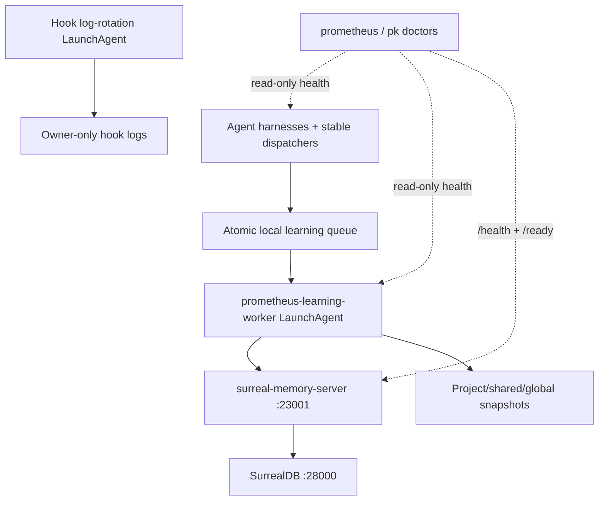

# Doctors and Mac certification

Run diagnosis with explicit exclusions before any repair:

```bash
prometheus doctor --json \
  --exclude control.kbd-runtime \
  --exclude state.kbd-orchestrator \
  --exclude control.kbd-rollout \
  --exclude remote-queue
```

Selection happens before excluded checks are constructed or executed. The report’s `selection` object records the requested check filter and exclusions.

Generate a non-mutating repair plan:

```bash
prometheus doctor --json --refresh --dry-run \
  --exclude control.kbd-runtime \
  --exclude state.kbd-orchestrator \
  --exclude control.kbd-rollout \
  --exclude remote-queue
```

Review every action. Apply only safe, reversible, in-scope actions with explicit confirmation.

## Managed binary check

`binaries.manifest` covers six binaries: `prometheus`, `pk`, `pk-cherry`,
`prometheus-learning-worker`, `surreal-memory-server` and `prometheus-exec`. It
is required. It fails when one of them is missing from the command directory
(`~/.local/bin`, or `PROMETHEUS_COMMAND_DIRECTORY`), is not executable, or on
macOS has no valid code signature.

When it passes, the details print two hashes per binary:

```text
prometheus: installed sha256 2552d31c…; source sha256 2552d31c…; signature valid
```

`installed` is the file in the command directory. `source` is the freshly built
file in the repository's build output. Doctor prints both and compares neither.

**On macOS the two hashes are never equal, even right after an install.** The
installers re-sign each binary ad hoc after copying it (`codesign --force --sign -`),
because copying breaks a binary's signature and Apple Silicon kills a binary whose
signature is invalid. Re-signing rewrites the file, so the installed copy hashes differently from
the build output it came from. On Linux nothing is re-signed and the hashes of a
freshly installed binary are equal.

What each hash is good for:

| Details show | Meaning | Action |
|---|---|---|
| `source sha256` equals `shasum -a 256` of the file you just built | Doctor is reading the build you think it is | None |
| `source sha256` does not change after a rebuild | Doctor is reading a different directory, or an older build | Correct where doctor looks (below) |
| `source sha256 not-built` | No built file at the expected path | Build it, or correct where doctor looks (below) |
| `installed sha256` changes after an install | The install replaced the binary | None |
| Hashes equal (Linux only) | The installed binary is the current build | None |

To confirm on macOS that an install took, compare the installed hash before and
after it, or check the binary's own `--version` and the running service's
`/health` version. To see what a reinstall would do, preview it with
`bash scripts/install-binaries.sh --dry-run`.

### Where doctor looks for the source

For the five Cargo-built binaries, doctor reads
`<workspace>/<target dir>/release/<name>`, where the target directory is
`CARGO_TARGET_DIR` when that variable is set and non-empty, and `target`
otherwise. A relative value is resolved against the workspace. Doctor does not
read Cargo config files.

`prometheus-exec` is the exception. Its build helper always copies the certified
output to `crates/prometheus-exec/target/release/prometheus-exec`, so doctor reads
that fixed path whatever the target directory is.

The workspace paths and the `prometheus-exec` path are relative to the working
directory. Run doctor from the repository root when you want source hashes.
Anywhere else, the exec source reads `not-built`, and so do the other five unless
`CARGO_TARGET_DIR` is an absolute path. The installed hashes and the pass or fail
result do not depend on the working directory.

On a machine that redirects build output only through `build.target-dir` in a
Cargo config file, doctor looks in the in-repository `target` directory. It then
reports `not-built`, or worse, the hash of a binary left there by an older build.
Export the same path as `CARGO_TARGET_DIR` on such a machine. Run doctor from a
shell that has the variable; a service started by launchd or systemd does not
inherit a shell profile.

## Learning checks

`prometheus doctor` reports the learning pipeline as three separate checks so that a slow receipt is never confused with a dead worker.

| Check | Required | Passes when | Repair |
|---|---|---|---|
| `learning.worker` | yes | `~/.local/bin/prometheus-learning-worker` exists and its service is loaded (`launchctl` on macOS, `systemctl --user` elsewhere) | `bash scripts/install-mcp-services.sh --restart` |
| `learning.queue` | no (never fails the run) | no record has been waiting longer than the stale threshold | see below |
| `learning.snapshots` | yes | project, shared and global each have a committed generation | `pk snapshot` in the canonical checkout |

**Queue staleness.** `learning.queue` reads `PROMETHEUS_LEARNING_QUEUE` (default `~/.prometheus/learning-queue`). A record in `pending`, `processing`, `memory/pending`, `memory/submitting` or `memory/accepted` is in flight, and passes, until it has gone unchanged for longer than `PROMETHEUS_LEARNING_STALE_AFTER` (default `6h`, the same default as the worker's `--stale-after`). Age follows the worker: `lastReceiptChangeAt`, else `firstAcceptedAt`, else `queuedAt`, else the file's modification time. Older records produce a warning, never a failure, so a backlog cannot fail `./install.sh`. Details list per-state counts (including `memory/stalled`), the oldest age and up to five oldest operation ids. When surreal-memory answers (3 s timeout), they also show `GET /api/v2/operations/stats` (`paused`, `oldest_nonterminal`) and each listed operation's server-side state.

Restarting services will not clear a stale record, because it is waiting on a receipt rather than on a dead process. The suggested actions are operator decisions:

- `prometheus-learning-worker quarantine --older-than 6h --dry-run`, then the same without `--dry-run`, to move stale records to `memory/stalled`;
- `prometheus-learning-worker release --all` to put quarantined records back;
- `POST /api/v2/operations/{id}/retry` or `/reject` to re-drive or dead-letter one operation on the memory server.

**Snapshot root.** `learning.snapshots` resolves the project root in this order: `PROMETHEUS_PROJECT_ROOT`; the nearest ancestor of the working directory with `.prometheus/project.json`; the main worktree, when the working directory is a linked git worktree (found with `git rev-parse --path-format=absolute --git-common-dir`); the working directory. Because `.prometheus/project.json` is tracked, a linked worktree contains it, so a linked worktree that has no project snapshot of its own defers to the main worktree when that one has one. The check prints the resolved root and where it came from. If the project snapshot is missing in a linked worktree, the check names the main worktree and warns against running `pk snapshot` in the linked one, which would create a divergent store.

## Codex memory check

`codex.memories` preserves its optional pass/warn/skip semantics. It passes only when `features.memories`, `memories.generate_memories` and `memories.use_memories` are all false and both known summaries (`memories/memory_summary.md`, sibling `memories_v2/memory_summary.md`) are absent. Malformed values/config are unhealthy; absence of an installed Codex preserves the existing skip behavior.

Doctor resolves the effective home and verifies the installed generation, manifest, ownership/containment and capability cache before offering a helper. The action uses a shell-quoted absolute `bash` command with explicit `CODEX_HOME`. Missing runtime/cache/verifier/helper yields installation remediation, never a broken relative executable. This config predicate does not prove CLI/profile overrides or in-flight sessions stopped. See [memory tiers](/docs/guide/memory-tiers#codex-user-configuration-policy).

## Allowed health matrix

Run and archive redacted output for:

- canonical `prometheus doctor --json` and `npm run doctor` parity;
- `pk doctor --json`;
- `cowork doctor`, `cowork toolchain status`, and `cowork toolchain check`;
- `scripts/prometheus-services.sh doctor`;
- `scripts/check-mcp-health.sh --json`;
- `prometheus learning status --json`;
- the targeted production integration gates required by the affected phase.

## Deployment topology



## Certification evidence

Required checks must be green. Every warning needs a written disposition. Archive exact command, exit code, commit, timestamp, sanitized environment, and report path. Run `scripts/certify-memory-operations.sh --long-memory` separately because it intentionally writes a certification memory; doctor remains diagnostic.
